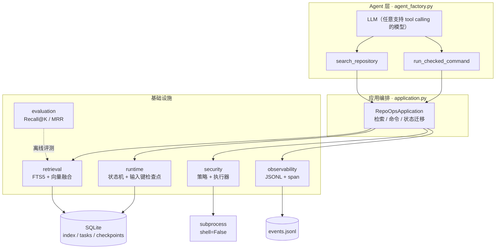
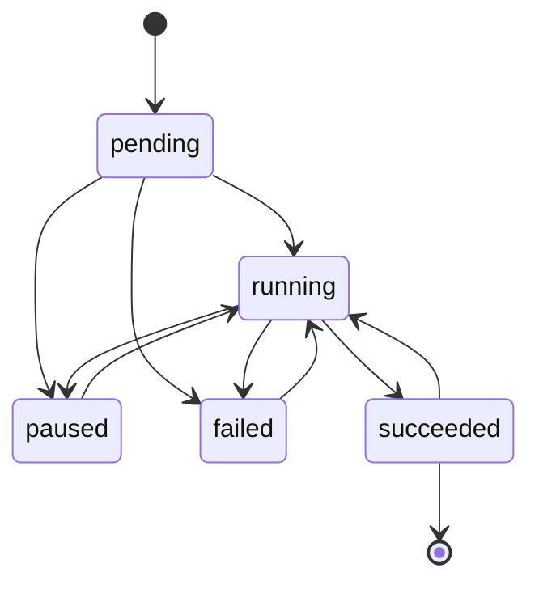

<div align="center">
  <h1>RepoOps Agent</h1>
  <strong>受控 · 可恢复 · 可评测的代码仓库 Agent 运行时</strong>
</div>

<div align="center">
  <a href="https://github.com/xing345/deepagents-repoops-2026/actions/workflows/ci.yml"></a>
  
  <a href="./LICENSE"></a>
  <a href="https://docs.astral.sh/ruff/"></a>
</div>

<br>

RepoOps 不是"会改代码的 Agent"，而是**给代码仓库 Agent 用的执行底座**：它让模型在仓库里做的每一次检索、每一次命令、每一步状态，都变得**可回归、可管控、可恢复**。

它建立在 [Deep Agents](https://github.com/langchain-ai/deepagents)（LangGraph 生态的 Agent harness）之上，只实现应用层：**16 个模块、约 1,200 行 Python、29 个离线用例**，不依赖模型 API Key，也不访问外网。

> **一句话**：把"让 Agent 在仓库里跑一次"变成"让 Agent 在仓库里跑得住"。

---

## 这不是什么

先把预期写清楚，避免误解：

- **不是代码修改 Agent**：不生成 patch、不自动提 PR。仓库级"读 issue → 改代码 → 跑测试"的闭环不在当前范围内。
- **不是沙箱**：执行边界是"策略控制的进程级边界"，不是 Docker / 微虚拟机。生产环境跑不可信代码仍应放进容器。
- **不是语义检索**：默认向量器是确定性的哈希词袋，用于离线回归与接口验证，不代表语义召回质量。

---

## 为什么做

让 Agent 在一个真实仓库里工作，难点不在"能不能搜到"，而在这三件事：

1. **检索不可回归**：换一次分块、换一个 embedding，检索质量是变好还是变坏，没有基线就说不清。
2. **命令不可控**：模型一旦能执行命令，`shell=True`、越界 cwd、敏感环境变量、无限输出都是事故入口。
3. **任务不可恢复**：长任务跑到一半进程挂了，重启后要么重头再来，要么在错误的状态上继续。

RepoOps 分别用**离线评测 / 执行策略 / 状态机 + 输入键检查点**来回答这三个问题。

---

## 核心能力

### 1. 混合代码检索

- 词法召回：SQLite **FTS5 + BM25**，精确匹配符号与关键字。
- 向量召回：`EmbeddingProvider` 协议可插拔；默认提供**确定性哈希向量器**（零依赖、可复现）。
- 加权融合：两路分数按权重（默认 0.55 / 0.45）融合，输出 Top-K。
- 行级定位：分块保留文件路径与起止行号，结果可直接跳转；默认 80 行窗口 / 12 行重叠。
- 覆盖 20 种后缀，自动跳过 `.git`、`.venv`、`node_modules`、`reports`、超大文件与二进制文件。

### 2. 任务状态机与输入键检查点

- 显式状态机：`pending → running → paused / succeeded / failed`，非法迁移直接抛错。
- **检查点键是 `(task_id, step, input_key)`**：同一个任务查两个不同 query 会得到两条检查点，而不是被 `(task_id, step)` 的唯一约束丢掉第二次结果。
- **只读步骤幂等**：相同 query 命中检查点直接返回，不重复检索；**命令不缓存**，因为它可能有副作用，检查点只用于审计。
- SQLite 持久化 + `version` 乐观锁；冲突时抛 `TaskConflict`，而不是静默覆盖。

### 3. 受控命令执行

- 工作区边界：cwd 必须位于仓库根目录内。
- 可执行文件白名单 + **参数数组**（拒绝 shell 字符串），底层固定 `shell=False`。
- 环境变量白名单，避免密钥被带入子进程。
- 默认 30s 超时、100KB 输出上限，超时/截断显式标记。

> 诚实边界：白名单放行 `python` 意味着 `python -c` 仍可执行任意代码；cwd 边界也不限制文件读写。它是"可控入口"，不是"隔离环境"。

### 4. 离线检索评测

- JSONL 数据集 + `Recall@K` / `MRR` / 平均延迟 / 失败样例。
- `repoops-eval` 命令一条跑完，产出 `reports/retrieval-eval.json`；CI 里带阈值，低于阈值直接失败。

当前基线（对 `src/` 自检索，12 条符号级查询）：

| 指标 | 值 |
| --- | --- |
| 用例 / 语料 | 12 条 / 29 个 chunk |
| Recall@5 | **1.000** |
| MRR | **0.875** |
| 平均延迟 | **2.04 ms** |
| 失败用例 | 0 |

> 这是**回归基线**，不是检索质量的证明：语料小、查询含精确符号，哈希向量也不具备语义能力。它的价值是"改动前后有对比"，不是"我的检索很强"。

### 5. 结构化遥测

- 每次检索 / 命令记录一条 JSONL 事件，携带 `task_id`、状态、耗时与自定义属性。
- `span` 上下文管理器负责分段计时，异常自动落 `failed`。
- token / cost 字段已建模，但**尚未接入模型回调**（见路线图）。

---

## 架构



**状态机**（`succeeded` 可被新步骤重新打开，因为一个任务里可能有多次检索/命令）：



---

## 快速开始

要求 Python ≥ 3.11 与 [uv](https://docs.astral.sh/uv/)。

```bash
git clone https://github.com/xing345/deepagents-repoops-2026.git
cd deepagents-repoops-2026
uv sync

uv run pytest -q          # 29 passed
uv run ruff check .
uv run ty check src
uv run repoops-eval       # 生成 reports/retrieval-eval.json
```

默认测试不需要任何模型 API Key，也不会访问外网。

### 离线使用（不接模型）

```python
from pathlib import Path

from repoops.application import RepoOpsApplication

app = RepoOpsApplication(repository_root=Path("."), state_dir=Path(".state"))
app.rebuild_index()
app.create_task("demo", "定位检索融合逻辑")

for hit in app.run_retrieval_task("demo", "lexical_weight vector_weight"):
    print(f"{hit.path}:{hit.start_line}-{hit.end_line} score={hit.score:.3f}")
```

### 接入 LLM

```python
from langchain.chat_models import init_chat_model

from repoops.agent_factory import create_repoops_agent
from repoops.application import RepoOpsApplication

app = RepoOpsApplication(Path("."), Path(".state"))
app.rebuild_index()
app.create_task("demo", "解释安全执行器")

agent = create_repoops_agent(init_chat_model("openai:gpt-4o-mini"), app)
result = agent.invoke(
    {"messages": [{"role": "user", "content": "task_id=demo：执行器有哪些策略约束？"}]}
)
```

注意：两个工具都要求传入已创建的 `task_id`。当前由模型从提示里读取，后续会改为运行时上下文注入。

---

## 设计取舍

**1. 检查点按输入建键，而不是按步骤建键。**
`(task_id, step)` 看起来更"干净"，但同一任务第二次检索不同 query 时，第二次结果会被唯一约束静默丢弃——恢复出来的状态是错的。加上 `input_key` 后，"同输入复用、异输入新增"才成立。

**2. 乐观锁冲突直接抛错，不自动重试。**
重试策略取决于调用方：检索可以重试，命令重试可能产生副作用。存储层只负责"发现冲突"，不替上层做决定。

**3. 命令不缓存，只审计。**
`pytest` 跑两次和跑一次不是一回事。把命令结果当缓存会制造"看起来恢复了、其实没执行"的假象。

**4. 为什么不用 LangGraph checkpointer？**
自研的动机是可审计（SQLite 可直接查）和输入键幂等；代价是与框架能力重复。如果后续要做多租户、跨进程恢复，优先迁移到框架 checkpointer，而不是继续加自研。

---

## 边界与已知限制

刻意写清楚，避免过度承诺：

- Agent 实际可用的工具不止两个：deepagents 默认还会挂载 `ls/read_file/write_file/edit_file/delete/glob/grep` 与 `task` 子代理。它们作用于 `StateBackend` 的内存文件，**不经过** `RepoOpsApplication` 的检查点、遥测与策略；`execute` 在默认后端下返回"不支持"。若换成 `LocalShellBackend`，执行策略会被绕过——这是 0.3 要收口的第一个问题。
- 进程级边界不等于沙箱；`python -c` 可逃逸，无网络隔离。
- 向量器是哈希词袋，不是语义模型；无 rerank、无 query 改写、无 AST 切分。
- 索引是全量重建，向量检索是全表扫描；十万文件级仓库需要增量索引与 ANN。
- 遥测未接模型 token / cost；无 HITL 审批。
- 评测是自检索回归，不代表真实仓库上的召回水平。

---

## 目录结构

```
.
├── src/repoops/
│   ├── application.py        # 编排：检索 / 命令 / 状态迁移
│   ├── agent_factory.py      # 装配 Deep Agent 工具
│   ├── storage.py            # SQLite 连接（WAL / busy_timeout / 关闭）
│   ├── retrieval/            # chunker / index / models
│   ├── runtime/              # task_store / checkpoints / models
│   ├── security/             # policy / executor
│   ├── evaluation/           # runner / cli / models
│   └── observability/        # events / telemetry
├── tests/                    # 29 个离线用例
├── evaluation/datasets/      # repoops_self.jsonl
├── reports/                  # 评测输出（已提交，便于对比）
└── .github/workflows/ci.yml  # pytest + ruff + ty + eval 阈值
```

## 与上游的关系

项目早期在 `langchain-ai/deepagents` 仓库内开发，现独立为单仓；本仓库**不包含**上游源码，只通过 PyPI 依赖 `deepagents`（MIT），应用层代码为本仓库原创。

## 路线图

- [ ] 收口 deepagents 默认文件工具与 `execute`（permissions / 工具裁剪）
- [ ] `task_id` 由运行时上下文注入，不再暴露给模型
- [ ] 模型 token / cost 回调接入遥测
- [ ] 增量索引 + 真实 embedding（bge）与 rerank，补消融表
- [ ] 容器沙箱适配器（Docker / nsjail）+ 威胁模型与红队用例
- [ ] 危险命令 HITL 审批

## License

[MIT](./LICENSE)